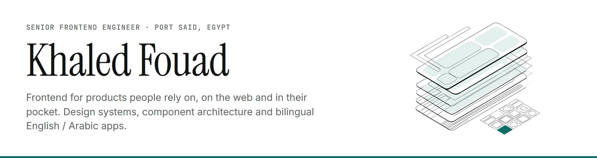
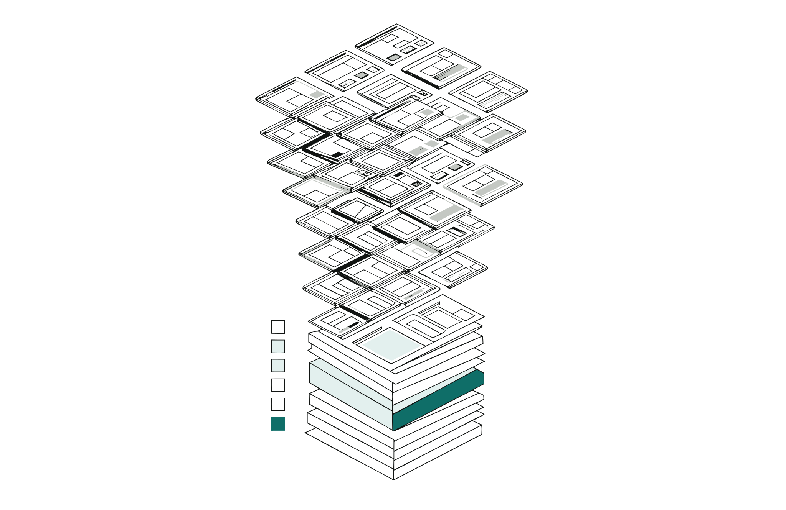
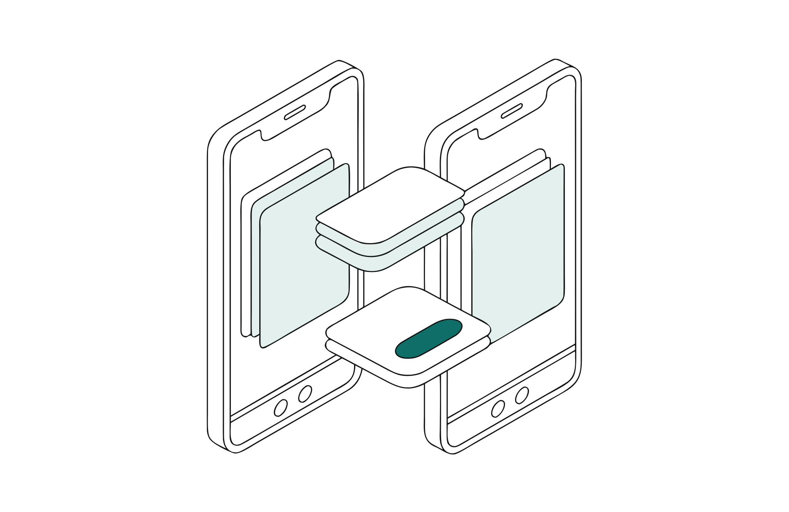
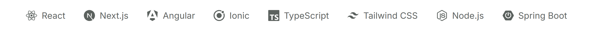

<a href="https://my-portofolio-eight-olive.vercel.app">
  <picture>
    <source media="(prefers-color-scheme: dark)" srcset="assets/header-dark.png">
    
  </picture>
</a>

  <a href="https://my-portofolio-eight-olive.vercel.app"><b>Portfolio</b></a>
  &nbsp;·&nbsp;
  <a href="https://www.linkedin.com/in/khaled-fouad-96a981285/"><b>LinkedIn</b></a>
  &nbsp;·&nbsp;
  <a href="mailto:khaled.fouadv9@gmail.com"><b>khaled.fouadv9@gmail.com</b></a>
  &nbsp;·&nbsp;
  <a href="https://my-portofolio-eight-olive.vercel.app/khaled-fouad-resume.pdf"><b>Resume</b></a>

I lead frontend work at **Insuretekk** and **East Port Said National University**: design systems, component
architecture, and bilingual English / Arabic apps on the web and on iOS and Android. Full-stack work in Node.js
and Spring Boot means I understand the backend behind the UI.

### Now

- **EPNU** · Senior Frontend Developer: own the frontend of the university's management platforms.
- **Insuretekk** · Senior Frontend Developer: lead a small frontend team; leading TameenNow Fidelity's PayTabs → N-Genius payment migration.

### Selected work

  <picture>
  <source media="(prefers-color-scheme: dark)" srcset="assets/art/epnu-attendance-dark.svg">
  
  </picture>
EPNU · BUILT FROM SCRATCH 
<b>Attendance &amp; HR Platform</b> 
Schedules, leave approvals, contracts, an attendance calendar and a live dashboard, with Excel and fingerprint imports and push notifications. Feature-based architecture, token-driven RBAC, <b>93 test files</b>. In production for university staff. 
<code>React 19</code> <code>TypeScript</code> <code>Vite</code> <code>Tailwind CSS 4</code>

 

  <picture>
  <source media="(prefers-color-scheme: dark)" srcset="assets/art/unihub-harbour-dark.svg">
  
  </picture>
EPNU · REFACTOR LEAD 
<b>UNIHUB refactor &amp; the Harbour design system</b> 
Moved the university management system to a component-based architecture: <b>268 views</b> migrated, <b>~21k lines</b> of inline JS removed, a <b>10k-line</b> stylesheet retired. Harbour adds light / dark tokens and a role-aware Ctrl+K search with Arabic, English and Franco synonyms. 
<code>CodeIgniter 4</code> <code>Bootstrap 5 RTL</code> <code>Vite</code>

 

  <picture>
  <source media="(prefers-color-scheme: dark)" srcset="assets/art/tameennow-dark.svg">
  
  </picture>
INSURETEKK · LEAD DEVELOPER 
<b>TameenNow Portal</b> 
Insurance agent app in production on Android and iOS: the full lead lifecycle (documents, quotations, payment proof, policy issuance), real-time chat on Firebase, FCM push and Crashlytics, and an Odoo CRM behind a layered interceptor chain. EN / AR via Transloco. 
<code>Angular 20</code> <code>Ionic 8</code> <code>Capacitor 8</code> <code>Firebase</code>

 

  <picture>
  <source media="(prefers-color-scheme: dark)" srcset="assets/art/epnu-admission-dark.svg">
  
  </picture>
EPNU · FRONTEND LEAD, TEAM OF 5 
<b>Admission Platform</b> 
Registration, document review, nominations and payments in Arabic RTL. Raised Lighthouse scores with a lean esbuild bundle, self-hosted fonts and content-hashed assets. 
<code>Django templates</code> <code>Tailwind CSS 4</code> <code>Alpine.js</code>

 

  <picture>
  <source media="(prefers-color-scheme: dark)" srcset="assets/art/locally-dark.svg">
  
  </picture>
TELEOCEANS · FRONTEND 
<b><a href="https://locallyeg.com">Locally</a></b> 
Live storefront for local Egyptian fashion brands: RTL layouts, Arabic typography and next-i18next localisation; Core Web Vitals work with SSR, lazy loading and CDN images.

 

Client code is private, so these are described by what they do and what changed. More on the [portfolio](https://my-portofolio-eight-olive.vercel.app).

### Daily stack

<picture>
  <source media="(prefers-color-scheme: dark)" srcset="assets/stack-dark.png">
  
</picture>

<b>Full toolbox</b>

 

| | |
| :-- | :-- |
| **Frontend** | React, Next.js, Angular, TypeScript, JavaScript, HTML, CSS |
| **Mobile** | Ionic, Capacitor (Android & iOS), Firebase, store releases |
| **UI & styling** | Tailwind CSS, design systems, Bootstrap 5, RTL / Arabic layouts |
| **State, data, forms** | TanStack Query, RxJS, React Hook Form, Zod, Transloco, next-i18next |
| **Backend** | Node.js (Express, NestJS, Fastify), Spring Boot, REST, WebSockets, AWS |
| **Data & infra** | PostgreSQL, MySQL, Redis, Kafka, Docker, Vite, CI/CD |
| **Practice** | RBAC, CQRS, design patterns, Vitest, code review, mentoring |

### Side projects

- **Advanced E-Commerce**: event-driven Java 21 / Spring Boot microservices behind Spring Cloud Gateway; CQRS (PostgreSQL + Elasticsearch), Saga over Kafka, Redis inventory locking.
- **SandBox-FS**: a browser code playground (Next.js, Monaco, xterm.js) that runs Python, Node.js, Go and C++ in isolated Docker containers via BullMQ / Redis.

B.Sc. Computer Science, Port Said University (Very Good with Honors) · ITI Scholarship, first place in group
